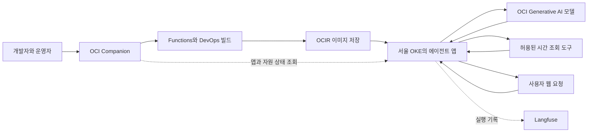

# OCI Agent Launchpad

**고객의 요구를 명세로 정리하고, 그 명세를 기준으로 애플리케이션과 AI 에이전트를 개발·확장하여 Oracle Cloud Infrastructure(OCI)의 배포·운영으로 연결하는 개발 기반입니다.** 고객과 함께 개발하는 엔지니어, 앱 개발자, OCI 운영 담당자를 대상으로 합니다.

AI에게 답변을 받는 데서 출발해 **업무 도구 실행 → 권한과 승인 확인 → 기억 저장 → 배포 → 실행 기록 확인**까지 연결하는 것이 목표입니다. 업무마다 필요한 기능을 선택하고, 검증한 코드·환경 설정·운영 전 보완 목록을 함께 전달합니다.

현재는 **엔지니어 동행형 알파**입니다. 준비된 환경에서 모델·도구 실행, VM·OKE 배포, 기억 저장·검색, 실행 추적을 확인했습니다. 새 고객 환경에 한 번에 설치하는 완성 제품이나 운영 서비스는 아직 아닙니다. [알파 제공 범위](ALPHA.md)

## 처음 실행하기 — 계정 없이 SDD 흐름 확인

Git과 **Python 3.12 이상**을 준비하세요. 아래 경로는 추가 패키지·OCI 계정·AI 도구 없이 실행할 수 있습니다. macOS·Linux 터미널에서 시작합니다.

```sh
git clone https://github.com/devmrko/oci-agent-launchpad.git
cd oci-agent-launchpad
python3 --version
python3 -S examples/enterprise-ai-web/cli.py 2
mkdir -p .run
python3 -S scripts/sdd_demo.py --output .run/sdd-demo
```

계산 결과에 `200000`과 `model_used: false`, 체험 결과에 `DEMO_PASS`가 표시되면 첫 실행이 완료된 것입니다. 체험은 복사한 파일에서 **요구 검토 → 명세 연결 → 테스트 → 요구·코드 변경 감지**를 수행합니다. 합성 요구를 사용하며 앱을 자동 개발하거나 고객 승인·배포를 수행하지 않습니다.

이미 저장소를 받았다면 그 폴더에서 `python3 --version`부터 실행하세요. 체험을 다시 실행할 때는 `.run/sdd-demo-2`처럼 새 출력 이름을 사용합니다. 기존 결과는 덮어쓰지 않습니다. `python3`가 없거나 버전이 낮으면 Python 3.12 이상을 먼저 설치해야 합니다.

[체험 결과 읽기](specs/sdd-walkthrough/README.md)에서 변경 감지 결과를 확인하고, [요구별 테스트 결과 남기기](specs/test-evidence/README.md)로 이어가세요. 화면으로 계산하려면 별도 터미널의 저장소 루트에서 다음 명령을 실행합니다.

```sh
python3 -S examples/enterprise-ai-web/server.py --offline
```

`http://127.0.0.1:8768`에서 숙박 일수를 입력할 수 있습니다. 서버를 종료하려면 터미널에서 `Ctrl+C`를 누릅니다. 포트를 이미 사용 중이면 기존 서버를 종료하거나 `--port 8769`로 실행하고 해당 주소를 여세요.

## 명세를 중심으로 확장하기

SDD는 요구 명세를 기준으로 설계·구현·테스트와 변경을 이어가는 방식입니다. 고객 인터뷰는 요구를 얻는 한 방법이며, 기존 문서나 직접 작성한 명세로도 시작할 수 있습니다. 결과물은 웹·API·업무 자동화·AI 에이전트가 될 수 있고, AI는 필요한 기능에 선택적으로 연결합니다.

**요구 명세 → 설계 → 구현 작업 → 코드와 테스트 → 배포와 검증 근거**를 Git에서 함께 관리하는 방향입니다. 특정 챗봇이나 개발 도구가 필수 입구가 되지 않도록 일반 Markdown·JSON·소스 파일을 사용합니다.

첫 사례인 [출장비 SDD 예제](specs/travel-allowance/README.md)는 기존 앱에 명세를 연결하고 **OCI 계정 없이 실행하는 규정 계산**을 추가했습니다. 요구 6개와 코드·테스트 연결, 로컬 실행을 확인했습니다. 웹의 계산 API와 CLI가 같은 규정 함수를 사용하며 제공 형태는 필요에 따라 선택합니다. [숙박 상한 10→14박 변경 사례](specs/travel-allowance/change-14-nights.md)에서는 요구 수정부터 실제 앱 변경과 경계 테스트까지 확인할 수 있습니다. 인터뷰에서 자동 생성하는 전체 흐름과 이 앱의 OCI 배포 증거 연결은 후속 단계입니다.

[인터뷰 근거 연결 도구](specs/interview-handoff/README.md)는 JSON 답변을 요구 초안으로 옮기고 원문·검토 기록을 연결합니다. 미정 답변은 유지하며, 요구나 인터뷰가 바뀌면 재검토로 표시합니다. 초안을 자동으로 고객 확정 요구로 승격하거나 코드를 변경하지 않습니다.

[변경 영향 검사](specs/change-impact/README.md)는 검토한 요구를 구현 명세에 연결하고, 변경된 요구·코드·테스트와 다시 살펴볼 시험 목록을 보여줍니다. 연결 파일은 일반 JSON이며 실제 테스트·배포 실행과는 구분합니다.

[요구별 테스트 결과](specs/test-evidence/README.md)는 연결된 테스트를 실제 실행해 요구 ID별 결과와 파일 해시를 JSON으로 남깁니다. 코드가 바뀌면 재실행이 필요하다고 표시합니다. OCI 계정 없이 출장비 예제로 확인할 수 있습니다.

자신의 기능을 시작하려면 [직접 입력한 요구로 명세 만들기](specs/spec-starter/README.md)를 사용하세요. 목적과 요구에서 편집 가능한 명세·설계·작업·연결 파일을 만들며, 구현과 검증이 필요한 초안으로 표시합니다.

[두 번째 적용 사례인 Hello Agent](specs/hello-agent/README.md)에서는 기존 시간 조회 앱에 지원 도시 목록을 추가하고, 같은 작업 전달·검증 도구를 재사용했습니다.

다른 개발자나 도구에 구현을 맡길 때는 [변경 작업 지시서 만들기](specs/developer-handoff/README.md)로 요구·합격 조건·코드 위치를 정리할 수 있습니다. [선택한 실행 명령을 별도 작업 폴더에서 호출](specs/developer-runner/README.md)할 수 있으며, 별도 프로젝트 루트를 지정해 반환된 구현의 테스트도 실행하고, 원래 요청·변경 파일·테스트 상태를 검토 보고서로 모을 수 있습니다.

[실제 Codex CLI 적용 사례](specs/developer-runner/codex-integration.md)는 Hello Agent의 영문 도시 목록 요구를 전달해 구현을 받고, 반환된 변경을 검토·재검증한 뒤 원본에 반영한 과정입니다. 특정 개발 도구를 필수로 지정하지 않고 같은 명세와 검증 절차를 사용합니다.

검증한 출장비 앱을 다른 사람이 실행하도록 전달하려면 [로컬 실행 ZIP 만들기](specs/offline-package/README.md)를 참고하세요.

코드를 수정하거나 기여하려면 [로컬 검사와 자동 검증 안내](CONTRIBUTING.md)를 참고하세요.

## 어떤 문제를 해결하려고 하나요

예를 들어 고객이 “직원이 사내 규정을 물어보고, 필요하면 지원 요청까지 접수하는 AI를 만들고 싶다”고 요청할 수 있습니다. 이때 모델 연결 외에도 규정 조회, 사용자 인증, 접수 승인, 데이터 저장, 배포, 장애 원인 확인이 필요합니다.

이 프로젝트는 그 작업을 작은 실행 예제로 나누고 OCI 구성과 연결합니다.

| 고객이 원하는 일 | 이 프로젝트에서 보여주는 방법 |
|---|---|
| 회사 규정을 찾아 안내하기 | Service Desk가 합성 규정에서 근거를 찾아 응답합니다 |
| 업무를 실제로 처리하기 | 요청 초안을 보여주고 사용자가 승인하면 접수합니다. 서버에서 사용자 소유권과 중복 실행을 검사합니다 |
| 다음 대화에도 필요한 정보 유지하기 | Oracle Agent Memory와 데이터베이스를 연결해 사용자가 명시적으로 저장한 기억을 검색합니다 |
| 개발 PC 밖에서 실행하기 | 앱을 패키징하고 OCI VM 또는 OKE에 배포합니다 |
| 어떤 단계에서 문제가 생겼는지 보기 | 모델·도구·답변 기록을 Langfuse에서, 앱·배포 상태를 Companion과 OCI에서 확인합니다 |

고객과의 진행 순서는 **업무 인터뷰 → 성공 조건 합의 → 작은 예제 구현 → 실제 실행 검증 → OCI 배포 → 운영 인수**입니다. AI-DLC는 이 공동 개발 과정을 정리하는 방법론입니다. [고객 입력 양식](templates/use-case.md) · [공동 개발 프로그램 계획](docs/oci-ai-dlc-plan.md)

## 무엇을 조합했나요

하나의 프로그램에 모든 기능을 넣기보다, 역할이 다른 서비스와 라이브러리를 연결합니다. 아래의 “사용”은 해당 예제에서의 적용 범위를 뜻하며 모든 예제가 모든 구성요소를 사용하는 것은 아닙니다.

| 구성요소 | 맡는 역할과 선택 이유 | 현재 적용 범위 |
|---|---|---|
| **Launchpad — 이 저장소** | 업무 양식, 실행 예제, 배포 스크립트, Terraform, 검증·인수 문서를 묶어 같은 작업을 다시 수행할 수 있게 합니다 | 예제와 도구 제공. 고객별 전체 설치 자동화는 미완료 |
| **Python Foundation** | 인증·웹·DB 등 앱에서 반복되는 코드를 재사용합니다 | Hello Agent와 Service Desk의 공통 기반. 별도 저장소·패키지 의존성 |
| **OCI Generative AI** | 모델을 호출해 질문을 이해하고 필요한 동작을 선택합니다 | Hello Agent·Service Desk에서 실제 호출 검증 |
| **OCI Enterprise AI 기능** | Responses API로 모델과 관리형 계산 도구를 함께 사용합니다 | 별도 로컬 체험에서 실제 Python 실행 검증. 기존 앱 전체를 이전한 것은 아님 |
| **OCI Compute / OKE** | 개발한 앱을 실행합니다. Compute는 VM, OKE는 관리형 Kubernetes 환경입니다 | Service Desk VM·OKE와 Hello Agent OKE 실행 기록 |
| **OCI Functions / DevOps / OCIR** | 소스 빌드, 컨테이너 이미지 패키징·저장, 대상 환경 배포를 연결합니다 | Hello Agent의 빌드·배포 경로 검증. OCIR은 OCI Container Registry |
| **Terraform / OCI IAM / Vault** | 인프라를 코드로 구성하고, 자원 접근 권한과 비밀값을 관리합니다 | 인프라 모듈, workload 인증, Vault 기반 설치 경로. 운영 권한·회전은 추가 검증 필요 |
| **Oracle Agent Memory / ADB** | 사용자가 저장한 기억을 세션이 끝난 뒤에도 보관하고 의미로 검색합니다. ADB는 Autonomous Database입니다 | Service Desk의 명시적 저장·검색·사용자 격리 검증. 일반 답변 개인화는 미완료 |
| **Langfuse / OpenTelemetry** | 앱이 보낸 실행 기록으로 모델 입력·출력과 도구 결과를 함께 확인합니다 | Hello Agent와 Service Desk 추적 검증. 업무 품질 평가 운영은 후속 과제 |
| **OCI Companion** | 엔지니어가 빌드·배포를 실행하고 등록 앱과 OCI 자원 상태를 확인하는 별도 관리 도구입니다 | 기본 알파의 제공 과정에 사용. 이미 배포된 앱은 Companion과 독립 실행 |

Langfuse를 구성할 때 PostgreSQL은 관리 정보, ClickHouse는 관측 데이터 분석, Redis/Valkey는 큐·캐시, 객체 저장소는 이벤트·파일을 맡습니다. **이 저장소들은 사용자 기억을 보관하는 ADB와 용도가 다릅니다.** 실제 구성과 버전은 선택한 배포 환경을 기준으로 맞춥니다.

**OCI API Gateway·Identity Domains, ContextForge, OPA는 추가 연결 후보입니다.** 각각 서비스 진입·사용자 인증, 중앙 도구 중계, 공통 정책 판단을 보완하려는 구성으로, 현재 기본 예제에 모두 설치·통합됐다는 뜻은 아닙니다. [기능별 구성 계획](docs/oci-agent-platform-plan.md)

## 구성요소는 어떻게 연결되나요

아래는 기본 알파의 Hello Agent 배포와 실행 흐름입니다. 모델은 Ashburn에서 호출하고 앱은 서울 OKE에서 실행한 검증 구성을 기준으로 합니다.



앱이 모델에 요청하고, 모델이 선택한 도구와 인자를 앱이 검사한 뒤 실행합니다. **실제 업무 권한과 승인은 서버 코드에서 확인합니다.** 모델의 답변 자체가 실행 권한이 되지는 않습니다. Companion은 이 요청마다 호출되는 서비스가 아니라 구축·배포·관리를 돕는 도구입니다.

기억이 필요한 Service Desk에는 Oracle Agent Memory와 ADB를 추가합니다. 시간만 알려주는 Hello Agent에는 기억 DB가 필요하지 않습니다. 별도 Enterprise AI 체험은 로컬 Python 서버가 Responses API와 관리형 Code Interpreter를 호출하는 더 작은 구성입니다.

## 세 가지 예제로 확인할 수 있습니다

| 예제 | 무엇을 배울 수 있나요 | 사용하는 주요 요소 |
|---|---|---|
| [Hello Agent](examples/hello-agent/README.md) | “지금 서울 몇 시인가요?” → 모델이 도구 선택 → 서버 시계 조회 → 답변. 클라우드 빌드·배포·관측의 기본 예제입니다 | Python Foundation, OCI 모델, OKE, Companion, Langfuse |
| [Service Desk](examples/service-desk/README.md) | 규정 안내 → 요청 초안 → 사용자 승인 → 접수. 사용자별 기억과 실행 통제로 확장합니다 | Python Foundation, 업무 DB, OCI 모델, Oracle Agent Memory·ADB, 추적 |
| [Enterprise AI 로컬 체험](examples/enterprise-ai-web/README.md) | 가상 출장비를 질문하고, OCI가 Python을 실행한 코드·출력·최종 답변을 확인합니다 | Python 웹 서버, OpenAI Python SDK, OCI IAM 인증, Responses API, Code Interpreter |

Enterprise AI 체험은 OpenAI SDK의 요청 형식을 사용하지만 **실제 요청 대상은 OCI**입니다. Foundation·Companion·OKE·ADB 없이 해당 관리형 기능만 체험할 수 있습니다. [Enterprise AI 쉬운 설명과 콘솔 위치](docs/oci-enterprise-ai-introduction.md)

## 가장 작은 예제부터 실행하기

**시간 조회 도구의 동작을 보려면** 저장소 루트에서 실행합니다.

```sh
python3 -S examples/hello-agent/agent.py --mode demo '지금 서울 몇 시인가요?'
```

결과의 `decision`에 `get_time`, `tool_result`에 실행 시점의 서울 시간이 표시됩니다. 이 모드는 규칙 기반 시연이며 `model_used: false`를 표시합니다.

**실제 OCI 모델과 계산 도구를 사용하려면** [로컬 웹 체험의 시작 안내](examples/enterprise-ai-web/README.md#시작하기)를 따릅니다. OCI 인증, ACTIVE 상태의 Generative AI 프로젝트, 모델 호출 권한이 필요하며 사용료가 발생할 수 있습니다. 화면은 로컬에만 열리고 모델 요청은 지정한 OCI 리전으로 전송됩니다.

**OCI 배포까지 확인하려면** [알파 준비·실행 순서](ALPHA.md)에서 환경과 고정 버전을 준비합니다. 이 경로는 Companion과 Python Foundation, OCI 자원 및 Langfuse가 필요합니다. Python Foundation 저장소는 현재 비공개이므로 별도 접근 권한이나 제공받은 패키지가 필요합니다. 이 저장소의 공개가 그 의존성이나 시험 환경 접근 권한까지 제공하지는 않습니다.

## 지금 확인한 것과 남은 일

| 범위 | 확인한 내용 | 남은 일 |
|---|---|---|
| Hello Agent 배포 | 준비된 환경에서 Functions 빌드, 이미지 패키징, OKE 배포, 실제 모델·도구 호출, Langfuse 조회, Companion 상태 확인 | 새 고객 환경 전체 재현, 기본 OKE 경로의 복구·정리 실습 |
| Service Desk | 규정 안내, 승인·중복 방지, OCI 호출, 명시적 기억 저장·검색, 일부 추적 경로 | 운영 사용자 인증, 업무 데이터 운영 구성, 자동 개인화 |
| Enterprise AI 체험 | 기본 응답과 Python 실행 출력. 로컬 웹 API에서 3박 → 30만 원 및 임시 환경 삭제 확인 | 파일 검색·장기 기억·관리형 앱 호스팅. 로컬 웹 화면의 시각 검증 |
| 운영 인수 | 입력 양식, 고정 버전 명세, 검증 기록, 운영 전 보완 목록 | 고객별 인증·TLS·상시 연결, 관측 재전송, 업무 평가, 비용·복구 목표 검증 |

검증 기준일은 **2026년 11월 9일**입니다. 준비된 환경의 성공 기록이며 고객 환경 전체의 운영 준비 완료를 의미하지 않습니다. 현재 범위의 근거는 [Hello Agent 인수 기록](examples/hello-agent/DELIVERY.md), [Oracle 메모리 검증](docs/oracle-agent-memory.md), [Service Desk 추적 검증](deploy/SERVICE-DESK-LANGFUSE.md), [Enterprise AI 실험 결과](docs/oci-enterprise-ai-introduction.md#실제로-확인한-결과)에 있습니다.

## 저장소를 찾아보는 방법

| 경로 | 들어 있는 것 |
|---|---|
| `examples/` | 실행할 수 있는 업무·학습 예제와 테스트 |
| `deploy/` | 빌드·패키징·배포·검증 도구와 실행 절차 |
| `infra/terraform/` | OCI 인프라를 구성하는 모듈 |
| `templates/` | 고객 업무·성공 조건·환경 요구를 정리하는 양식 |
| `docs/` | 목표 구조, 설계 판단, 검증 결과와 제한 |
| `releases/` | 기본 알파에 사용할 구성요소와 버전 명세 |
| `scripts/` | Enterprise AI 단독 호출 등 보조 실행 예제 |

자세한 작업은 [소스 빌드](deploy/BUILD.md), [OKE 배포 명세](deploy/OKE-MANIFESTS.md), [VM 설치와 Vault 연결](deploy/bootstrap-runtime.md), [Companion 연결](deploy/COMPANION-CONNECTIONS.md), [현재 진척도](docs/status.md)에서 확인할 수 있습니다. [OCI Companion 저장소](https://github.com/devmrko/oci-companion)는 독립적으로 관리합니다.

이 프로젝트는 Oracle 또는 AWS의 공식 프로그램·제품 로드맵이 아닙니다. OCI 우선 구성과 필요한 오픈소스 조합을 검토·검증하는 프로젝트이며, 다른 에이전트 플랫폼과의 완전한 기능 동등성을 약속하지 않습니다.
