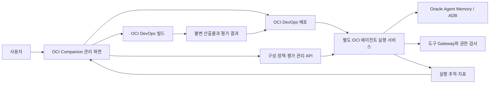

# 독립 에이전트 플랫폼과 Companion의 연동 범위

2026-11-06 · 상태: 현재 동작 확인 + 확장 설계 제안. 신규 관리 기능 구현 완료를 뜻하지 않습니다.

사용자가 원하는 결과는 OCI Companion에서 소스를 선택하고, 빌드한 버전을 배포한 뒤 에이전트의 상태와 실행 결과를 확인하는 것입니다. 추가로 AgentCore에 대응하는 구성 요소를 Companion에 포함할지 검토하도록 요청했습니다.

**사용자 확정 방향: AgentCore 대응 플랫폼과 OCI Companion은 독립 프로젝트이며, Companion은 플랫폼의 구축·운영을 돕습니다.** 플랫폼은 Companion 없이도 CLI/API/Terraform으로 배포·사용할 수 있어야 합니다. Companion이 중지돼도 실행 중 에이전트의 모델·메모리·도구 호출은 계속 동작해야 합니다.

플랫폼 구축 과정에서 필요한 Companion 기능을 발견하면 Companion에 구현합니다. 예를 들어 빌드 산출물과 배포를 연결하는 기능은 Companion의 개선 과제이며, 도구 권한 검사를 실제로 강제하는 기능은 플랫폼의 과제입니다. 아래 관리 화면 제안은 이 연동을 위한 것이며 플랫폼 기능을 Companion 내부에 종속시키는 의미가 아닙니다.

## 지금 실제로 되는 일

| 사용자 행동 | 현재 확인한 결과 | 남은 부분 |
|---|---|---|
| Companion에서 빌드 | 일반 OCI 빌드 구성·실행·로그·산출물 전달 코드가 있음 | Launchpad 프로젝트에는 소스 저장소, 외부 연결, 빌드 파이프라인이 없음. 이번 0.4.1 패키지는 Companion 외부에서 빌드함 |
| Companion에서 배포 | 기존 VM 배포·복구 검증에 더해 새 bootstrap VM도 화면에서 실행하여 SUCCEEDED 확인 | 현재는 미리 준비한 단일 VM 파이프라인. 빌드 결과에서 배포 대상으로 이어지는 연결 미완성 |
| Companion에서 모니터링 | 새 VM UP / 0.4.1, 모델·승인·메모리 실행 추적을 실제 화면에서 확인 | 로컬 SSH 터널·설정된 합성 앱 계정·수동 갱신 방식. 다중 고객 전체 관측 아님 |
| Companion에서 최초 환경 준비 | VM 환경 조회·구성 기능과 별도 Terraform 템플릿이 있음 | VM·ADB·Vault·IAM 일괄 준비를 Companion에서 끝내는 흐름은 없음 |
| AgentCore 주요 기능 사용 | 앱 실행, 제한된 세션·메모리·승인·추적 예제가 동작 | 중앙 Gateway, 위임 인증, 공통 정책·평가, 격리 코드·브라우저 실행 등은 별도 구현 필요 |

코드에 화면이 존재하는 것, OCI 작업이 성공한 것, 사용자 업무가 성공한 것은 별도로 기록합니다. 이번 Companion 배포는 이미 설치된 **동일 0.4.1 패키지의 재배포**이며 신규 버전을 Companion에서 빌드한 증거는 아닙니다.

## 역할과 데이터 경계

- **OCI Companion / Spring 기반:** 프로젝트·소스·빌드·릴리스·환경·에이전트 구성의 관리 화면, 작업 요청, 상태 대조, 감사 기록. 요청을 보낸 상태와 원격 완료 상태를 구분합니다.
- **Python Foundation:** 앱이 공유하는 인증 주체, 오류·트랜잭션, 도구 실행 계약, 메모리 어댑터·계측 같은 코드. 모든 운영 기능을 범용 라이브러리에 밀어 넣지 않습니다.
- **OCI Agent Launchpad:** AI-DLC 템플릿, 예제, 배포 구성과 통합 검증. 독립 운영 서비스가 필요해지면 해당 코드를 명확한 모듈로 분리하고 배포합니다.
- **실행 서비스:** 긴 작업·모델 호출·메모리·도구 실행·중단·복구를 담당합니다. Companion 웹 프로세스를 에이전트의 실행 서버로 사용하지 않습니다.

Companion에는 Secret 식별자만 보관하고 실제 비밀값은 권한을 가진 실행 주체가 읽습니다. 사용자 로그인, VM의 OCI 접근, 외부 도구에 대한 사용자 위임은 서로 다른 권한입니다. 기존 데모 토큰 조회 연결은 운영 관리자 권한 모델을 대신하지 않습니다.

## AgentCore 기능별 플랫폼 구현과 Companion 지원 범위

2026-11-06 확인한 [AWS AgentCore 공식 개요](https://docs.aws.amazon.com/bedrock-agentcore/latest/devguide/what-is-bedrock-agentcore.html)의 기능 목록을 비교 축으로 사용했습니다. 아래의 화면·구현 방식·순서는 이 프로젝트의 제안이며 AWS 서비스의 기능·성능 동등성을 주장하지 않습니다.

| 비교 기능 | 현재 OCI 예제 | Companion이 지원할 관리 기능 | 실제 실행 위치와 미구현 범위 | 순서 |
|---|---|---|---|---|
| Runtime | 단일 VM·systemd·버전 확인·재시작 검증 | 실행 환경, 배포 버전, 준비 상태, 재시작·복구 이력 | OCI 실행 서비스. 세션별 강한 격리·자동 확장·장기 작업 복구는 미구현 | 1 |
| Memory | Oracle Agent Memory/ADB 저장·검색, 재부팅 보존 검증 | 저장소 연결·상태, 범위·보존 설정, 권한 있는 조회·삭제 작업 | 기억은 ADB가 정본. 관리 API·보존/삭제 작업·다중 고객 경계 검증 필요 | 1 |
| Observability | 앱 요청·모델·도구·메모리 추적 조회 | 버전별 오류·지연·사용량, 요청 상세, 배포와 연결 | 현재 앱 API에서 읽음. OTEL/APM 수집·알림·전체 사용자 관측은 미구현 | 1 |
| Identity | 앱 Actor, 데모 인증, VM Instance Principal, Vault | 사용자·에이전트·도구의 권한과 Secret 참조, 연결 상태 | 운영 IdP·사용자별 외부 OAuth 위임과 회전 흐름은 미구현 | 2 |
| Gateway | 예제 내부의 제한된 도구 호출 | 도구 등록·명세·버전·접근 범위·연결 시험 | 별도 Gateway 서비스. 공통 MCP/OpenAPI 연결과 중앙 차단 미구현 | 2 |
| Policy | 고정 승인 규칙·소유권·중복 방지 | 정책 버전·허용/거부 시험·승인 조건·감사 | 실행 직전 서버가 강제. 중앙 정책 서비스·모든 경로 적용은 미구현 | 2 |
| Evaluations | pytest·합성 smoke 검증 | 데이터셋, 버전별 평가 실행·비교, 배포 통과 기준 | 별도 평가 작업자/CI. 일반적인 온라인·오프라인 품질 평가 서비스 미구현 | 2 |
| Registry | 소스와 패키지 저장소는 있음 | 에이전트·도구·스킬 등록, 소유자·버전·승인·의존성 | 메타데이터 카탈로그. 패키지 Artifact Registry와 구분. 등록부 미구현 | 1에서 최소 등록부, 2에서 확장 |
| Code Interpreter | 없음 | 사용 허용, 제한 시간·자원·네트워크, 작업 결과·감사 | 별도 격리 worker. Companion이나 일반 앱 프로세스에서 임의 코드 실행 금지 | 3 |
| Browser | 없음 | 사용 허용 도메인, 세션 상태, 산출물·감사, 승인 | 별도 격리 브라우저 worker. 고객별 세션·쿠키 격리 검증 필요 | 3 |
| Harness | 특정 사내 지원 업무 흐름만 있음 | 사용할 프레임워크·실행 설정·모델/도구 연결 | 기존 프레임워크를 재사용하는 실행 계층 제안. 범용 관리형 루프는 미구현 | 3 이후 별도 검토 |
| Optimization | 없음 | 평가 결과와 개선 후보·승격 승인 | 평가·버전 관리 이후 검토. 자동 변경과 자동 승격은 기본값으로 두지 않음 | 후속 |
| Payments | 없음 | 현재 필수 범위에 포함하지 않는 안 | 유료 도구 결제 요구가 생기면 별도 검토. 기존 주요 기능 요구에 자동 추가하지 않음 | 보류 제안 |

Browser와 Code Interpreter는 기존의 주요 기능 제공 목표에 남깁니다. 개별 예제에서 사용하지 않는 것과 플랫폼에서 구현하지 않은 것을 혼동하지 않습니다. Harness·Optimization·Payments까지 최신 서비스 목록 전체를 구현한다는 범위 확정은 아직 하지 않았습니다.

## 먼저 완성할 사용자 흐름

1. **프로젝트 등록:** 기존 소스 선택 화면에서 Launchpad 소스와 고정 Foundation 의존성을 연결합니다. 사설 저장소 접근은 재사용 가능한 적정 범위의 연결로 준비하고 개인 개발 PC의 인증 파일을 빌드에 복사하지 않습니다.
2. **빌드:** Companion에서 OCI Managed Build를 시작합니다. Linux x86/Python 3.12 환경에서 테스트하고 앱 wheel·고정 의존 wheel·manifest를 묶습니다. 현재 패키징 스크립트를 재사용하되 OCI build spec과 Foundation 공급 경로를 작성·검증해야 합니다.
3. **배포본:** 성공한 빌드 실행 ID, 소스 커밋, Foundation 버전, 패키지 ID·SHA-256, 평가 결과를 하나의 불변 릴리스 기록으로 연결합니다. 현재 메뉴의 미구현 ‘배포본’을 이 연결에 사용합니다.
4. **배포:** 사용자가 릴리스와 환경을 고르면 실제 대상·필수 구성·변경 내용을 확인합니다. 실행 전 상태를 다시 검증하고 OCI 작업 ID를 기록합니다. VM의 허용 manifest 등록을 수동 root 파일 편집에 의존하지 않도록, 승인된 릴리스의 설치 허용을 관리 작업으로 전달하는 계약이 필요합니다.
5. **검증과 운영:** 배포 성공 후 실제 health 버전·메모리 연결·대표 업무 검증을 확인합니다. 원격 결과가 불명확하면 성공이나 무조건 재시도로 처리하지 않습니다.

완료 기준은 **개발 PC에서 wheel을 만들거나 VM에 SSH로 설치하지 않고, Companion에서 시작한 빌드의 산출물이 선택한 VM에 배포되고 동일 릴리스의 실행 추적이 보이는 것**입니다. 최초 테넌시/권한 준비와 지원되지 않는 인프라 구성은 관리자 작업으로 명시합니다. 추후 Companion의 ‘환경 준비’에서 승인된 Terraform/Resource Manager 작업을 요청·조회하는 범위를 별도로 추가할 수 있습니다.

## 필수·옵션 설정 계약 초안

아래 필드는 설계 제안이며 아직 실행 가능한 manifest 포맷이 아닙니다. 앱 실행 설정과 관리 설정의 정본·버전을 정한 뒤 실제 API와 맞춥니다.

| 구분 | 항목 | 의미 |
|---|---|---|
| 필수 | 프로젝트·소유자·OCI 연결 범위 | profile/tenancy/region/compartment와 접근 주체 |
| 필수 | 소스 revision·Foundation 버전·빌드 정의 | 같은 결과를 추적할 수 있는 빌드 입력 |
| 필수 | 산출물 ID·checksum·앱 버전 | 배포본을 임의로 바꿔치기하지 못하게 고정 |
| 필수 | 실행 환경·health 계약·인증 방식 | 대상 VM/실행 서비스와 준비 상태 판정 |
| 필수 | 관측 위치·보존 정책·민감정보 처리 | 요청 추적과 운영 책임 |
| 조건부 필수 | 메모리 저장소·namespace·Secret 참조·보존 | 메모리를 활성화할 때. 비밀번호 값은 제외 |
| 조건부 필수 | 도구 목록·정책 revision·승인 조건 | 외부 도구 또는 변경 작업을 허용할 때 |
| 조건부 필수 | 평가 데이터셋·통과 기준 | 평가를 배포 차단 조건으로 사용할 때 |
| 옵션 | 코드/브라우저 worker 연결 | 격리 시험을 통과한 기능만 활성화 |
| 옵션 | 스트리밍·비동기·동시 실행·비용 한도 | 요구에 맞춰 선택하되 선택한 기능의 한계와 검증 표시 |

화면에는 ‘미구현’, ‘미설정’, ‘검증 대기’, ‘정상’, ‘실패’, ‘알 수 없음’을 구분합니다. 단순 enabled 값만으로 기능 제공 여부를 표시하지 않습니다. 메모리 검색 화면에서 관리자에게 모든 사용자 기억을 자동 노출하지 않고 명시적 범위·권한을 확인합니다.

## 단계별 완료 기준

| 단계 | 범위 | 완료 증거 |
|---|---|---|
| 0 | 현재 VM 배포·모니터링 연결 | Companion 실행 SUCCEEDED, 새 VM UP·같은 버전·추적 확인. 이번에 완료 |
| 1 | 빌드→불변 배포본→배포→운영 + 최소 에이전트 등록부 | 같은 소스 커밋·빌드 ID·패키지 해시·배포 ID·앱 버전이 화면에서 연결됨 |
| 2 | Memory 관리, Identity/Gateway/Policy, 평가 | 사용자 간 접근 차단, 거부 시 무실행, 승인 매개변수 고정, 품질 미달 시 배포 차단 |
| 3 | 격리 코드·브라우저·비동기 실행 | 네트워크·파일·세션 경계, 시간·자원 제한, 중단·재시작·정리 검증 |

운영용 외부 접근은 현재 로컬 SSH 터널 데모와 별도입니다. TLS·관리자 인증·고객별 권한·관측 연결을 검증한 뒤 전환합니다. 단일 VM이 있다고 세션 격리나 관리형 서비스 수준 가용성을 제공한다고 표시하지 않습니다.

## 근거와 한계

현재 코드 확인: Companion `HttpAgentMonitoring`, `DeploymentRunPages`, `OciDeploymentRuns`, `OciBuildSetup`, `BuildTaskPages`; Launchpad 배포·메모리 검증 스크립트와 Terraform. Companion 작업 브랜치의 기능이며 upstream main 전체에 통합됐다고 주장하지 않습니다.

실제 검증: 새 VM 전용 DevOps 자원 8개를 별도 `bootstrap-vm` Terraform workspace로 생성했고 후속 plan은 No changes였습니다. Companion에서 시작한 첫 배포는 이전 부팅 오류로 남은 staging 상위 경로의 root 0700 권한 때문에 실패했습니다. 새 VM의 그 경로만 0755로 정상화한 뒤 **Companion에서 다시 시작한 배포가 SUCCEEDED**였습니다. 모니터링 연결은 이전 설정·토큰을 보관하고 새 로컬 터널 8094로 전환했습니다. 기존 VM과 파이프라인은 유지합니다.

독립성과 지원 관계는 사용자가 확정했습니다. 기능별 UI·우선순위·세부 구현은 제안이며 전체 구현 완료를 의미하지 않습니다. 플랫폼은 독립 실행 검증, Companion은 빌드·배포·운영 지원 검증으로 완료 기준을 나눕니다. 빌드 연계가 가장 먼저 필요한 실제 기능 공백입니다. 전체 진척도와 다음 작업은 [현재 상태](status.md)를 참고하세요.
