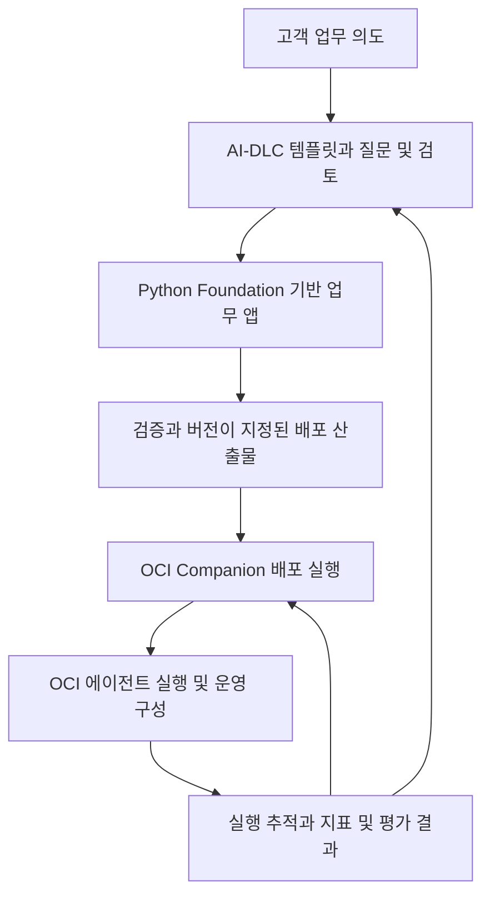

# OCI Companion과 Python Foundation을 연결하는 계획

기록일: 2026-11-05 | 상태: 예제 구현·로컬 검증 중 | OCI 연결 확인 | 원격 배포 미실시

## 사용자가 정한 방향

AI-DLC를 근거로 한 상세 템플릿으로 요구사항과 설계를 정리하고, 사용자가 만든 python-foundation과 OCI의 AgentCore 대체 구성을 활용하여 애플리케이션을 만듭니다. 이 애플리케이션을 사용자가 개발 중인 OCI Companion에서 배포하고 모니터링하는 흐름을 목표로 합니다.

사용자 요청 근거: “내가만든 python-foundation … 이거랑 이 oci(agentcore대용품)을 가지고 만들어서 oci comapanion에서 배포하고 모니터링해보는거”. 이 방향은 기존 템플릿·예제 요구를 유지하면서 개발에서 운영까지 연결할 실제 적용 대상을 정한 것입니다.

## 구성요소별 역할

| 구성요소 | 맡길 역할 | 구분할 경계 |
| --- | --- | --- |
| OCI Agent Launchpad | AI-DLC 기반 진행 지침, 필수·옵션 양식, 예제와 검증 절차 | 별도 범용 배포 관리 화면을 중복 개발하지 않음 |
| python-foundation | Python 애플리케이션의 공통 개발 기반 | 고객별 업무 로직과 데이터 모델은 소비 앱이 소유 |
| OCI AgentCore 대체 구성 | 에이전트 실행, 세션·메모리, 도구 권한, 추적·평가 기반 | 기반 라이브러리와 실제 OCI 서비스 설정·운영을 구분 |
| 예제 또는 고객 앱 | 업무 기능과 도구, 수용 기준, 업무 평가 | 라이브러리 버전을 고정하여 사용 |
| OCI Companion | 프로젝트의 빌드·배포 실행과 상태 확인, 운영 관측 연결 | 업무 요청을 처리하는 에이전트 런타임과 별도 역할 |

이 역할 분담의 세부 인터페이스는 설계 제안입니다. 저장소를 합치거나 OCI Companion을 Python으로 재작성한다는 뜻은 아닙니다.

## 목표 흐름

모니터링 결과는 다음 요구·설계·평가 개선에도 사용합니다. 템플릿 예제는 로컬 응답 확인에서 끝내지 않고 배포한 버전과 실제 요청의 결과를 연결하는 과정을 보여줘야 합니다.

## 현재 확인한 범위와 추가 확인 사항

2026-11-05에 Companion의 머지된 `f56ed41`을 받아 빌드·실행했습니다. JDK 21에서 `scripts/build.sh`가 성공했고, 로컬 웹에서 기존 OCI 프로파일로 연결하여 리전·구획 목록을 조회했습니다. 이전 버전 README만 근거로 작성했던 아래 기능 평가는 최신 코드와 실행 화면 기준으로 교체했습니다.

| 대상 | 확인한 내용 | 남은 연계 |
| --- | --- | --- |
| [OCI Companion](https://github.com/devmrko/oci-companion/tree/f56ed41) | 리소스·소스·빌드 관리, 빌드 명세·로그·보고서·레지스트리 관련 코드 제공 | 예제 소스 등록과 실제 OCI 빌드 실행은 미검증 |
| 배포 환경 | `DeploymentEnvironmentPages`가 기존 환경·VM 조회, 인스턴스 검사, 환경 생성 경로 제공 | 예제 배포 대상 확정 필요 |
| 배포 실행 | 새 `/deployments`는 배포 환경 화면을 공유. 기존 파이프라인 실행은 legacy 경로와 구분 필요 | 새 화면의 환경 생성이 앱 배포 성공을 의미하지 않음; 산출물→배포 파이프라인 연결 검증 필요 |
| 모니터링 | 현재 메뉴가 미구현으로 표시됨 | 예제 실행 추적 API와 운영 관측 백엔드 연결 필요 |
| [python-foundation](https://github.com/devmrko/python-foundation/tree/e8798f9397d6391d39d9159a801dfa5ec7908663) | 버전 0.1.0의 인증 Actor·Security, 웹 오류 처리, DB factory·UnitOfWork를 예제에서 직접 사용 | 실제 JWT 공급자·운영 DB 검증 필요 |

Companion의 현재 패키지는 실제 OCI 연결을 사용합니다. 이전 버전의 데모 모드나 자동화 제약을 최신 버전에도 그대로 적용하지 않습니다. 소스·빌드 기능의 코드 존재와 실제 이 예제를 배포한 증거 역시 구분합니다.

## 플랫폼 전체 목표와 첫 검증의 구분

사용자는 AgentCore의 주요 기능 제공을 요구했습니다. 첫 예제 앱의 배포·모니터링은 연결 검증이며 전체 플랫폼의 완료 기준이 아닙니다. 메모리, 도구 Gateway, Identity, Policy, 관측, 평가, 격리 코드 실행과 브라우저 실행까지 [주요 기능 기준](oci-agent-platform-plan.md#주요-기능-제공-요구와-완료-기준)에 따라 계획합니다. Companion에서는 각 기능의 설정·상태·결과를 확인할 수 있는 범위를 설계하며, 앱별 미사용 옵션과 플랫폼 미구현 상태를 구분합니다.

## 첫 연결 검증 제안

첫 검증 단위는 [사내 안내·요청 접수 예제](../examples/service-desk/README.md)입니다. 합성 규정 검색, 요청 초안과 승인, 사용자별 기억·추적을 제공합니다. 아래 흐름 중 로컬 검증까지 진행했으며 원격 배포는 남아 있습니다.

1. 상세 템플릿으로 업무 의도, 필수·옵션 선택, 수용 기준을 작성합니다.
2. python-foundation을 사용하여 앱을 구성하고 모델·도구 호출이 있는 대표 업무 흐름을 검증합니다.
3. 앱 버전, Foundation 버전, 배포 산출물 식별자와 필요한 설정을 확정합니다.
4. OCI Companion에서 준비된 빌드·배포 경로를 실행하고 원격 상태를 확인합니다.
5. 배포된 앱에 요청을 보내 모델 호출·도구 호출·결과를 같은 요청 식별자로 추적합니다.
6. 정상 사례와 통제된 실패 사례를 모니터링에서 구분하고, 어떤 버전에서 발생했는지 확인합니다.

최초 배포 후보는 Companion의 현재 문서상 경로와 맞는 VM입니다. 최종 실행 환경은 아직 확정하지 않았습니다. Container Instances·관리형 실행·OKE를 선택하면 Companion에 필요한 배포 연동을 추가 과제로 드러내야 합니다. 기존 플랫폼 계획의 실행 환경 후보를 자동으로 Companion 지원 기능으로 취급하지 않습니다.

## 연결 계약으로 설계할 항목

| 계약 | 필요한 정보 또는 동작 |
| --- | --- |
| 빌드·배포 | 프로젝트·환경, 소스 커밋, Foundation 버전, 산출물의 변경 불가능한 식별자, 실행 대상, 설정과 비밀정보 참조 |
| 상태 확인 | 배포 요청 식별자, 원격 실행 식별자, 마지막 조회 시각, 성공·실패·미확인 상태 구분 |
| 앱 준비 상태 | 프로세스 생존과 업무 요청 처리 가능 여부의 구분, 의존 서비스 장애 처리 |
| 실행 관측 | 앱·배포 버전, 요청·추적 식별자, 모델·도구 단계, 시간·오류·사용량 |
| 평가 | 업무 사례, 기대 결과, 실제 결과, 평가 대상 버전과 실행 환경 |
| 복구·종료 | 실패 시 확인 절차, 재시도 판단, 기존 배포 유지·복구, 자원 종료와 보존 책임 |

계약의 필드명, API와 저장소는 아직 결정하지 않았습니다. 예제마다 임의의 연동 방식을 만들기 전에 기존 프로젝트의 인터페이스와 중복 여부를 확인합니다.

## 모니터링의 범위

배포 파이프라인 성공과 에이전트 업무 성공은 별도로 보여야 합니다.

- 배포: 어떤 버전이 어디에 올라갔는지, 요청과 원격 작업이 어떤 상태인지.
- 앱: 준비 상태, 요청 수, 지연시간과 오류.
- 에이전트: 모델·도구 실행 흐름, 실패 단계, 권한 거부, 사용량과 비용 추정.
- 업무: 수용 기준과 평가 결과, 실제 작업 완료 여부.

Companion은 관측 데이터를 모두 직접 저장하는 대신 기존 관측 백엔드의 조회·링크 또는 필요한 요약을 제공하는 방식을 우선 검토합니다. 구체적인 표시 방식과 데이터 수집 위치는 후속 설계 사항입니다. 비밀값과 대화 원문 전체를 자동 수집하는 것으로 전제하지 않습니다.

## 완료 판단 기준 제안

- Companion의 배포 이력과 실제 배포 앱 버전을 대조할 수 있습니다.
- 실제 요청의 응답과 모델·도구 실행 추적을 연결할 수 있습니다.
- 배포 실패, 앱 오류와 업무 평가 실패를 구분할 수 있습니다.
- 원격 상태를 모를 때 성공으로 표시하거나 같은 작업을 무조건 재전송하지 않습니다.
- 다른 진행자가 템플릿과 예제를 따라 같은 흐름을 재현할 수 있습니다.

예제 코드·설계·설치 절차를 작성하고 로컬 시험을 진행했습니다. 다음 단계는 배포 대상(리전·구획·VM) 확정, 실제 모델 연결, 버전이 지정된 산출물 생성, Companion 배포 실행 연동과 관측 화면 연결입니다. 실제 OCI 리소스 생성·앱 배포는 아직 하지 않았습니다.

## 첫 예제의 배포 입력 계약

| 항목 | 현재 값 또는 필요한 입력 |
| --- | --- |
| 앱 소스 경로 | `examples/service-desk` |
| Foundation | `e8798f9397d6391d39d9159a801dfa5ec7908663`, 0.1.0 |
| 의존성 | 예제 `requirements.lock`; 사설 Foundation 소스를 먼저 확보해야 함 |
| 실행 | 설치한 환경의 `python -m uvicorn service_desk.app:create_app --factory --host 127.0.0.1 --port 8092` |
| 상태 확인 | `GET /health`, 현재 DB 연결과 앱 버전 반환 |
| 인증 | demo는 로컬 합성 시험용. 원격 운영에는 Foundation JWT 설정과 TLS·접근 범위 확정 필요 |
| 상태 | SQLite 파일 보존 경로 또는 운영 DB·마이그레이션 결정 필요 |
| 추적 | 인증된 사용자의 `GET /api/traces`; Companion의 관리자 권한을 사용자 토큰으로 대체하지 않음 |
| 미확정 | 리전·구획·대상 VM, 비용 한도·종료일, 실제 모델 공급자, 이미지/패키지 저장소 |

배포용 산출물은 비밀키·로컬 DB·OCI 설정을 포함하지 않아야 합니다. 현재 설치 스크립트는 로컬 실행을 검증하기 위한 것으로, 그대로 OCI 빌드 명세라고 표시하지 않습니다.
