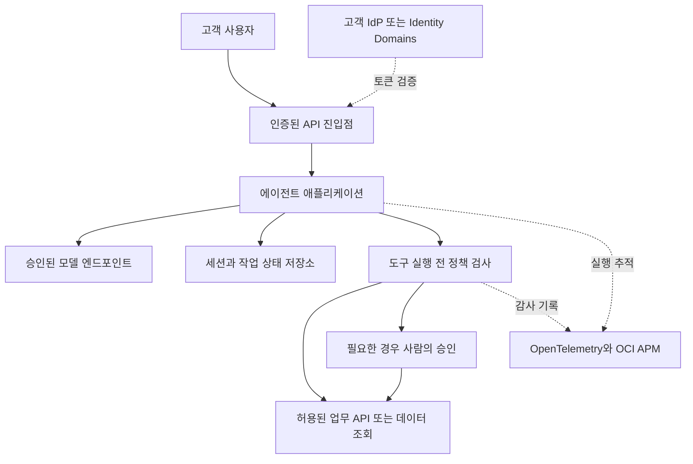

# AgentCore 기능을 OCI에서 대체하는 구성 계획

작성일: 2026-11-05 | 상태: 검토용 설계 초안 | 실행·배포: 미실시

## 목표와 설계 방향

OCI에서 고객의 에이전트를 운영할 수 있도록 실행 환경, 세션과 메모리, 도구 권한, 관측과 평가를 조합하는 구성을 제안합니다. 현장 담당자가 매번 이 기반을 처음부터 만들지 않고 고객의 업무 로직에 집중할 수 있게 하는 것이 목적입니다. [고객 공동 개발 프로그램](oci-ai-dlc-plan.md)의 공통 기술 기반으로 사용합니다.

AgentCore는 AWS 서비스이며 OCI에 같은 제품이 있는 것은 아닙니다. 이 계획은 AgentCore의 모든 기능과 API를 복제하지 않습니다. 첫 고객 업무에 필요한 기능부터 대체하고, 동일하지 않은 격리·자동화·운영 책임을 명확히 합니다.

Oracle 공식 문서에는 OCI Generative AI Applications의 관리형 컨테이너 실행과 Enterprise AI의 대화·메모리·도구 기능이 안내되어 있습니다. 따라서 관리형 기능을 활용하는 경로와 일반 컴퓨트 위에 직접 구성하는 경로를 함께 검토합니다. 해당 기능이 목표 리전·테넌시에서 제공되는지, 필요한 제약을 충족하는지는 착수 전 검증 대상입니다. 문서 확인만으로 사용 가능 또는 AgentCore와 동등하다고 결론 내리지 않습니다. [OCI 실행 환경](https://docs.oracle.com/en-us/iaas/Content/generative-ai/deploying-agents.htm), [Enterprise AI 기능](https://docs.oracle.com/en-us/iaas/Content/generative-ai/agents.htm)

## AgentCore 기능별 대응안

AgentCore의 공식 설명은 Runtime, Memory, Gateway, Identity, Observability, Evaluations, Policy, 코드·브라우저 실행 등의 역할을 구분합니다. 아래는 역할에 대한 대응 설계이며 일대일 제품 동등성 표가 아닙니다. [AgentCore 개요](https://docs.aws.amazon.com/bedrock-agentcore/latest/devguide/what-is-bedrock-agentcore.html)

| 필요한 역할 | OCI에서 검토할 구성 | 직접 구현하거나 검증할 부분 | 도입 시점 |
| --- | --- | --- | --- |
| 에이전트 실행 | Generative AI Applications 또는 Container Instances, 필요 시 OKE | 수명주기, 동시성, 스트리밍, 장시간 작업, 재시작 복구, 세션 격리 수준 | 최소 구성 |
| 에이전트 판단·도구 반복 실행 | 애플리케이션의 프레임워크 또는 OCI Responses API | 단계 수·시간·비용 제한, 중단·재시도, 상태 전이 | 최소 구성 |
| 대화 세션 | 앱의 세션 저장소 또는 OCI Conversations | 소유자 검사, 순서·중복 제어, 동시 요청 처리, 만료·삭제 | 최소 구성 |
| 장기 메모리 | DB와 검색 계층 또는 검증된 OCI 관리형 메모리 | 저장 동의, 추출·갱신 규칙, 출처, 사용자 분리, 삭제 전파 | 초기 선택 기능 |
| 사용자 인증 | Identity Domains 또는 고객 IdP와 API Gateway | 사용자·조직 식별 전달, 업무 권한 검사, 토큰 만료 처리 | 최소 구성 |
| 외부 도구용 자격 증명 | IAM 주체, Vault, 고객 인증 체계 | 사용자 위임, OAuth 갱신·철회, 자격 증명별 사용 범위 | 도구별 도입 |
| 도구 연결 | 앱의 도구 실행 계층과 필요한 MCP 서버 | 도구 명세, 입력 검증, 권한 확인, 제한 시간, 재시도·중복 방지 | 최소 구성 |
| 업무 정책 | 도구 실행 직전의 서버 정책 검사 | 사용자·조직·자원·행위별 허용, 승인 흐름, 우회 경로 차단 | 최소 구성 |
| 실행 추적 | OpenTelemetry와 OCI APM, 로그·메트릭 | 모델·도구·메모리 span, 원가 추정, 민감정보 제거, 세션 연결 | 최소 구성 |
| 품질 평가 | 버전 관리된 평가 세트와 실행기 | 정답·권한·도구 효과 검증, 회귀 기준과 결과 보존 | 최소 구성 |
| 코드 격리 실행 | 검증된 관리형 sandbox 또는 별도 격리 워커 | 파일·네트워크·CPU·시간 제한과 폐기, 신뢰 경계 검증 | 필요한 업무만 |
| 브라우저 실행 | 별도 브라우저 워커 또는 승인된 외부 서비스 | 세션 격리, 쿠키·로그인 보호, 목적지 제한, 종료·폐기 | 초기 제외 |
| 도구·에이전트 카탈로그 | Git의 승인된 명세와 릴리스 목록 | 소유자, 버전, 허용 범위, 배포·폐기 이력 | 최소 목록부터 |
| 자동 최적화·에이전트 결제 | 별도 요구 검토 | 실험 통제와 금전 행위 승인 | 초기 제외 |

OCI API Gateway는 토큰 검증과 경로별 권한을 제공하지만 그 자체가 AgentCore Gateway의 MCP 도구 변환·발견·실행 정책을 모두 대체하지는 않습니다. 도구 연결과 업무 권한 검사를 별도 책임으로 둡니다. [Oracle 토큰 인증 문서](https://docs.oracle.com/en-us/iaas/Content/APIGateway/Tasks/apigatewayusingjwttokens.htm)

## 실행 환경 선택안

| 경로 | 적용 조건 | 장점 | 남는 책임 |
| --- | --- | --- | --- |
| 관리형 실행 환경 | Generative AI Applications가 대상 환경에서 사용 가능하고 요구 충족 | 배포·엔드포인트·실행 설정 부담을 줄일 가능성 | 실제 인증·네트워크·할당량·세션 동작·운영 도구 검증 |
| Container Instances | 소수의 컨테이너로 파일럿을 운영하고 직접 조합이 필요 | Kubernetes 없이 실행 기반 구성 가능 | 배포 교체, 확장·가용성 설계, 상태 저장, 에이전트 계측 |
| OKE | 기존 Kubernetes 운영 역량이 있거나 워커·확장·배포 제어가 필요 | 공통 플랫폼 운영과 세밀한 제어 | 클러스터·정책·업그레이드와 에이전트 계층 모두 운영 |

Container Instances는 서버를 직접 관리하지 않고 컨테이너를 실행하는 서비스입니다. Kubernetes가 필요하지 않은 API·웹·개발 환경 등에 사용할 수 있지만, 이 사실만으로 에이전트별 메모리·정책·평가가 제공되는 것은 아닙니다. [Container Instances 개요](https://docs.oracle.com/en-us/iaas/Content/container-instances/overview-of-container-instances.htm)

제안하는 결정 순서는 관리형 실행 환경의 적합성을 짧게 검증하고, 조건을 만족하지 못하면 Container Instances로 파일럿을 구성하는 것입니다. 기존 OKE 기반 고객은 OKE를 먼저 비교할 수 있습니다. 운영 전환 시 확장·복구 요구로 실행 환경이 바뀌더라도 업무 API와 외부 상태 저장 계약을 유지합니다.

## 3일 워크숍을 위한 최소 구성

첫 파일럿은 고객별 독립 환경과 인증된 내부 사용자만 대상으로 합니다. 신뢰할 수 있는 애플리케이션 코드만 실행하고, 모델이 생성한 임의 코드를 같은 프로세스에서 실행하지 않습니다.

진입점은 API Gateway 또는 검증된 관리형 엔드포인트를 선택합니다. 관리형 인증이 충분하면 기능이 중복되는 게이트웨이를 무조건 추가하지 않습니다. 그림의 세션·도구·정책 계층은 논리적 책임이며, 최소 구성에서는 하나의 애플리케이션 안에 모듈로 둘 수 있습니다.

사용자 요청에서 신뢰할 수 있는 사용자·조직 정보를 얻고, 세션 소유권을 확인합니다. 모델이 도구 사용을 제안하면 서버가 입력과 권한을 검사한 후 실행합니다. 결과와 작업 상태를 기록하고 사용자에게 응답합니다. 각 단계는 동일한 추적 식별자로 연결합니다.

최소 구성에 포함할 항목은 다음과 같습니다.

- 업무 흐름 한 개, 읽기 전용 도구 중심의 작은 도구 목록과 승인된 모델 한 개.
- 인증, 세션 소유권 검사, 사용자별 데이터 접근과 도구 실행 정책.
- 세션·작업 상태를 저장하는 데이터베이스 한 종류. 캐시와 별도 벡터 저장소는 필요가 입증될 때 추가.
- 단계 수·총 실행 시간·모델 토큰·도구 호출 제한, 요청 중단 처리.
- 모델·도구 지연시간과 오류를 확인할 추적, 비밀정보를 제거한 로그.
- 정상 흐름, 잘못된 입력, 다른 사용자 데이터 접근, 도구 실패를 포함한 평가 세트.
- 재배포·종료·데이터 보존 절차와 비용 알림. 비용 알림은 지출 차단 장치와 다르므로 애플리케이션 실행 한도도 별도로 둠.

이 공통 기반을 고객 워크숍 3일 안에 처음부터 개발한다는 계획은 아닙니다. 프로그램 준비 단계에서 검증하고 고객별 업무에 적용해야 합니다.

## 상용 운영으로 확장할 구성

상용 구성은 동시 사용자 수, 지연시간, 가용성, 복구 목표와 데이터 정책을 합의한 뒤 결정합니다. 처음부터 모든 기능을 설치하지 않습니다.

| 확장 조건 | 추가할 구성 | 검증할 결과 |
| --- | --- | --- |
| HTTP 요청보다 긴 업무 | 내구성 있는 작업 큐, 별도 워커, 작업 상태 API | 연결이 끊겨도 결과 조회, 취소·재시도, 중복 실행 방지 |
| 여러 인스턴스 실행 | 외부 상태 저장, 동시성 제어, 배포·트래픽 전환 | 재시작과 배포 중 대화·작업 일관성 |
| 가용성·복구 요구 | 실패 영역을 고려한 배치, 백업·복구, 운영 알림 | 합의한 복구 시간·데이터 손실 목표 내 복구 |
| 외부 시스템 변경 | 승인 상태 저장, 멱등성 키, 보상 또는 수동 복구 | 중복 요청이 중복 주문·지급으로 이어지지 않음 |
| 민감 데이터·여러 고객 | 더 강한 네트워크·자원 격리와 권한 경계 | 사용자·조직 간 데이터와 비밀정보 접근 차단 |
| 장기 개인화 | 메모리 생성·검증·삭제 작업과 보존 정책 | 잘못 저장된 기억의 수정, 출처·삭제 상태 확인 |
| 높은 품질 요구 | CI 평가, 제한 사용자 검증, 운영 표본 평가 | 버전 변경에 따른 품질 저하 탐지와 롤백 |

HTTP 진입점에는 무한 실행을 붙이지 않습니다. SSE·WebSocket·일반 HTTP 중 필요한 응답 방식을 정하고 각 홉의 제한 시간, 연결 종료, 프록시 버퍼링을 검증합니다. 장시간 업무는 비동기 실행으로 전환할 기준을 둡니다.

## 세션과 메모리 설계

세션, 실행 상태, 장기 기억을 서로 다른 개념으로 관리합니다.

| 구분 | 저장 내용 | 필수 제어 |
| --- | --- | --- |
| 대화 세션 | 대화 순서와 요약, 소유자, 만료 시점 | 소유권 검사, 보존 기간, 동시 요청 제어 |
| 실행 상태 | 작업 식별자, 단계, 도구 요청·결과, 승인 상태 | 중복 방지, 상태 전이, 실패·재시도 기록 |
| 장기 기억 | 지속적으로 사용할 확인된 사실과 출처 | 저장 범위, 수정·삭제, 신뢰도와 사용 조건 |

데이터 키는 고객·사용자·세션 경계를 표현하되, 클라이언트가 보낸 식별자를 신뢰하지 않습니다. 인증 결과로 범위를 결정하고 서버가 조회·쓰기 권한을 강제합니다. DB를 선택할 때도 애플리케이션 검사와 데이터 계층 통제의 책임을 정합니다.

Oracle 공식 문서는 대화 상태와 장기·단기 메모리, 프로젝트 단위 자원·보존 설정을 설명합니다. 이 경로를 선택하면 앱이 같은 정보를 이중 관리하지 않도록 정본을 정하고, 사용자 경계와 삭제 동작을 시험합니다. [OCI 에이전트 구성 요소](https://docs.oracle.com/en-us/iaas/Content/generative-ai/building-agents.htm)

자체 구현 경로에서는 DB 저장만으로 메모리 기능이 완성되지 않습니다. 무엇을 추출하고 언제 검색·갱신하며 잘못된 기억을 어떻게 배제할지 정해야 합니다. 첫 파일럿은 대화 상태만 유지하고 장기 기억은 기본적으로 끄는 안을 권장합니다.

## 도구 실행과 보안 경계

모델의 출력은 실행 제안으로 취급합니다. 사용자·도구·대상 자원·행위·입력값을 바탕으로 서버에서 허용 여부를 결정하고, 정책 확인이 실패하면 실행하지 않습니다. 시스템 프롬프트의 지시는 보조 수단입니다.

- 도구마다 입력 스키마, 허용 주체, 데이터 범위, 시간 제한, 재시도와 멱등성 여부를 등록합니다.
- 사용자 로그인 권한과 에이전트의 OCI 자원 접근 권한, 외부 SaaS 위임 권한을 분리합니다.
- Vault에 비밀값을 보관하는 것과 사용자별 위임 토큰을 안전하게 발급·갱신하는 것은 별도 구현입니다.
- 사람의 승인은 제안된 행위·대상·매개변수에 묶습니다. 승인 뒤 매개변수가 바뀌면 다시 검사합니다.
- 모든 실행 경로가 같은 정책 검사를 통과하게 하고 도구 서버와 원본 데이터 계층에서도 필요한 권한을 적용합니다.
- 감사 기록은 사용자, 행위, 정책 결과, 승인자와 결과를 연결하되 토큰·비밀번호를 남기지 않습니다.

프로세스가 다르거나 Kubernetes namespace가 다르다는 이유만으로 AgentCore의 세션 격리와 동등하다고 주장하지 않습니다. 신뢰하지 않는 코드·브라우저 작업은 별도 격리 실행을 검증하기 전까지 비활성화합니다.

## 관측과 품질 평가

OpenTelemetry로 요청, 모델 호출, 도구 호출, 메모리 조회와 승인 대기를 구분해서 계측하는 안을 제안합니다. OCI APM은 OTLP 데이터를 수집할 수 있지만, 에이전트의 업무 성공률이나 응답 정확도가 자동으로 정의되지는 않습니다. 앱 계측과 별도 평가가 필요합니다. [OCI APM OpenTelemetry 지원](https://docs.oracle.com/en-us/iaas/application-performance-monitoring/doc/configure-opentelemetry1.html)

운영 화면에서는 총 지연시간과 모델·검색·도구별 지연, 실패 원인, 반복 호출, 토큰 사용과 비용 추정, 사용자 업무 완료 여부를 구분합니다. 원문 프롬프트와 응답은 기본 전체 저장 대신 필요한 항목과 표본을 정하고, 보존 기간과 접근 권한을 적용합니다.

평가 세트는 업무 전문가가 기대 결과를 확인합니다. 자동 채점과 모델 채점은 보조로 쓰고, 데이터 범위·계산·권한·외부 부작용은 실행 결과와 기준값으로 검증합니다. 평균 응답시간만으로 판단하지 않고 상위 지연시간, 오류율과 실패 업무를 함께 봅니다.

관측 수집 장애가 발생했을 때 일반 조회를 계속할지, 감사가 필수인 변경 작업을 차단할지는 업무별 정책으로 정합니다. 추적 표본 수집과 반드시 보존할 감사 기록을 구분합니다.

## 공통 구성 검증 계획

아래는 구현을 승인받은 뒤 수행할 시험 계획입니다. 현재 결과는 모두 미검증입니다.

| 시험 | 통과 조건 | 실패 시 대응 |
| --- | --- | --- |
| 리전·할당량·모델 접근 | 대상 고객 계정에서 필요한 호출·배포 성공 | 대체 리전·경로와 데이터 이동 조건 재협의 |
| 사용자·세션 격리 | 다른 사용자의 식별자로 조회·실행해도 데이터 노출과 부작용 없음 | 파일럿 진행 중단, 권한 경계 수정 |
| 스트리밍과 장시간 요청 | 실제 경로에서 응답·연결 종료·타임아웃 처리 확인 | 비동기 작업 전환 또는 진입점 변경 |
| 재시작과 재배포 | 상태가 복구되고 완료된 변경이 중복 실행되지 않음 | 저장·체크포인트·멱등성 보완 |
| 도구 정책 | 허용·거부·승인 후 실행이 기대대로 동작 | 도구 비활성화 후 정책 수정 |
| 모델·도구 장애 | 제한된 재시도 후 사용자에게 상태를 알리고 중단 가능 | 재시도·회로 차단·수동 복구 설계 |
| 추적·로그 | 한 요청의 모델·도구 흐름 연결, 비밀값 미노출 | 계측과 마스킹 수정 |
| 평가 회귀 | 합의한 업무별 기준 충족, 중대 권한 위반 없음 | 이전 버전 유지와 실패 사례 보강 |
| 메모리 삭제 | 합의한 저장소·캐시·검색 경로에서 삭제 정책 이행 | 장기 메모리 비활성화 또는 보존 정책 수정 |
| 비용과 종료 | 호출 한도·알림·리소스 종료 절차 확인 | 실행 한도 강화와 범위 축소 |
| 복구 | 상용 운영 전 합의한 RTO·RPO 충족 | 운영 승인 보류와 복구 경로 보완 |

RTO는 장애 후 서비스 복구 목표 시간, RPO는 허용 가능한 데이터 손실 기간입니다. 구체적인 시간·처리량·정확도 목표는 고객 요구를 받은 뒤 수치로 정하며, 근거 없이 보장하지 않습니다.

## 직접 만들어야 할 최소 범위

새로운 범용 에이전트 플랫폼을 먼저 만드는 대신, 공통으로 필요한 얇은 계층부터 준비합니다.

1. 업무 API와 상태 저장 계약, 사용자·세션 검증.
2. 도구 명세와 실행 전 정책 검사, 승인·멱등성 처리.
3. 모델·도구·메모리의 공통 계측과 민감정보 제거.
4. 평가 사례·실행 결과의 버전 관리와 배포 통과 기준.
5. 선택한 실행 환경의 배포·롤백·종료 절차, 고객별 설정.

관리형 서비스가 이 역할을 충분히 제공하면 해당 구현을 줄입니다. 브라우저 자동화, 임의 코드 실행, 범용 에이전트 스토어, 다중 고객 SaaS 제어 화면, 자동 최적화는 첫 범위에 포함하지 않습니다.

## 준비 작업과 완료 기준

| 작업 | 주 담당 역할 | 완료 기준 |
| --- | --- | --- |
| 기능·리전 적합성 비교 | 플랫폼 아키텍트 | 문서상 지원과 실제 검증 결과를 구분한 선택 기록 |
| 최소 실행 구성 설계 | 플랫폼·개발 담당 | 데이터 흐름, 인증, 상태 저장과 장애 경계 합의 |
| 정책·메모리 설계 | 보안·데이터 담당 | 소유권, 도구별 권한, 보존·삭제 규칙 |
| 계측·평가 설계 | 검증 담당과 업무 전문가 | 대표 평가 세트, 지연·비용·성공 지표 |
| 공통 구성 구현과 시험 | 구현 승인 후 담당 팀 | 위 시험 결과와 재현 가능한 배포 자료 |
| 내부 리허설 | CE와 운영 담당 | 3일 일정 진행, 실패 복구, 후속 인수 가능 |

플랫폼 선택 기록에는 버전, 리전, 검증 날짜, 제한, 비용 가정과 운영 담당자를 남깁니다. 최종 선택은 고객 업무와 운영 역량에 맞춰 하며, 최소 구성이 통과하기 전에는 고객에게 AgentCore와 동등한 운영 경험을 약속하지 않습니다.

## 공식 자료와 확인 범위

모두 2026-11-05에 문서 내용을 확인했습니다. 실제 OCI 계정에서 배포·권한·성능·가격 시험은 하지 않았습니다.

- [AWS AgentCore 개요](https://docs.aws.amazon.com/bedrock-agentcore/latest/devguide/what-is-bedrock-agentcore.html): 대체해야 할 기능의 구분입니다.
- [OCI 에이전트 배포 개요](https://docs.oracle.com/en-us/iaas/Content/generative-ai/deploying-agents.htm): 관리형 컨테이너 실행과 배포 설정입니다.
- [OCI Enterprise AI Agents](https://docs.oracle.com/en-us/iaas/Content/generative-ai/agents.htm): API 기반 구성과 호스팅 구성의 구분입니다.
- [OCI Building Agents](https://docs.oracle.com/en-us/iaas/Content/generative-ai/building-agents.htm): 도구, 메모리와 프로젝트 자원 설명입니다.
- [OCI Container Instances](https://docs.oracle.com/en-us/iaas/Content/container-instances/overview-of-container-instances.htm): 일반 컨테이너 실행 후보입니다.
- [OCI API Gateway 토큰 인증](https://docs.oracle.com/en-us/iaas/Content/APIGateway/Tasks/apigatewayusingjwttokens.htm): 진입점 인증과 경로별 권한의 근거입니다.
- [OCI APM OpenTelemetry](https://docs.oracle.com/en-us/iaas/application-performance-monitoring/doc/configure-opentelemetry1.html): 분산 추적 수집 경로의 근거입니다.
