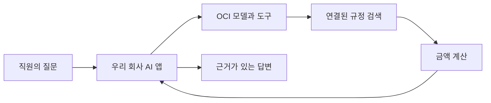

# OCI Enterprise AI 이해와 첫 체험

OCI Enterprise AI는 **회사 자료를 찾고, 필요한 도구를 사용하고, 대화를 이어가는 AI 비서를 만들 수 있도록 오라클이 제공하는 기능 묶음**입니다. 개발자는 회사의 업무와 자료를 연결하고, OCI는 모델 호출과 선택한 관리형 기능을 제공합니다.

이 안내는 처음 접하는 분을 위해 출장비 예시로 역할을 설명하고, OCI 웹 콘솔에서 간단한 대화를 체험하는 순서를 안내합니다. 기능과 메뉴는 2026년 11월 9일 공식 문서 기준입니다.

## 어떤 일을 도와주나요

직원이 다음과 같이 요청하는 상황을 생각해 보겠습니다.

> “부산으로 2박 3일 출장을 갑니다. 회사 규정상 숙박비를 최대 얼마까지 신청할 수 있나요?”

사람이 처리한다면 출장 규정을 열고, 숙박비 항목을 찾고, 숙박 일수에 맞춰 계산할 것입니다. AI 비서도 자료와 도구가 연결되어 있다면 이 과정을 도울 수 있습니다.

| 순서 | AI 비서가 하는 일 | 이 예시에서의 결과 |
|---|---|---|
| 1 | 질문의 뜻을 파악합니다 | 숙박비 한도를 묻고 있으며 숙박은 2박입니다 |
| 2 | 연결된 회사 규정을 검색합니다 | 예시 규정에서 1박 한도 10만 원을 찾습니다 |
| 3 | 금액을 계산합니다 | 2박 × 10만 원 = 20만 원입니다 |
| 4 | 근거와 함께 답합니다 | 최대 20만 원이며 적용한 규정도 보여줍니다 |

위 규정과 금액은 **설명을 위한 가상 데이터**입니다. 실제 회사의 규정은 직접 등록하거나 업무 시스템에 연결해야 합니다. 비용 신청까지 처리하려면 신청 기능과 사용자 권한, 승인 절차도 별도로 연결해야 합니다.

## 오라클과 개발자가 각각 맡는 일

AI 모델은 요청을 이해하고 답을 만드는 역할을 합니다. Enterprise AI는 모델에 자료 검색, 도구 사용, 대화 맥락 같은 기능을 함께 사용할 수 있게 합니다.

| OCI에서 제공하는 기능 | 쉬운 설명 |
|---|---|
| 모델 호출 | 질문을 이해하고 답을 생성하는 AI에 요청합니다 |
| File Search | 준비해 둔 파일에서 관련 내용을 찾습니다 |
| Code Interpreter | 코드를 실행하여 데이터 처리와 계산을 돕습니다 |
| Function Calling과 MCP Calling | 등록한 함수나 연결한 도구를 업무에 활용합니다 |
| 대화와 프로젝트 메모리 | 설정에 따라 대화 맥락과 기억을 관리합니다 |
| Applications | 개발한 에이전트 앱을 관리형 환경에 배포합니다 |

개발자는 어떤 자료를 사용할지, 어떤 작업을 허용할지, 결과를 어떻게 확인할지 정합니다. 특히 Function Calling에서 모델이 함수를 호출하겠다고 출력하는 것과 실제 업무 시스템에서 그 함수를 실행하는 것은 구분해야 합니다.

기존 앱에서 **Responses API**라는 호출 창구로 기능을 이용하거나, 앱 자체를 **Applications**에 배포할 수 있습니다. 두 방식을 함께 사용할 수도 있습니다. [Oracle 기능과 구성 설명](https://docs.oracle.com/en-us/iaas/Content/generative-ai/agents.htm)

## 요청이 처리되는 흐름



이 그림은 출장비 안내 앱의 구성 예시입니다. 회사 AI 앱이 사용자 요청을 받아 필요한 OCI 기능을 호출하고, 결과를 사용자에게 보여줍니다. 실제 신청이나 결재처럼 데이터를 변경하는 작업은 실행 전에 권한과 승인을 확인하도록 앱을 구성합니다.

## 웹 콘솔에서는 어디로 들어가나요

먼저 [OCI 콘솔](https://cloud.oracle.com/)에 로그인합니다. 상단에서 지원 리전, 예를 들어 **US Midwest (Chicago)**를 선택한 다음 아래 메뉴로 이동합니다.

**☰ → Analytics & AI → AI Services → Generative AI**

Generative AI 안에서는 목적에 따라 다음 메뉴를 사용합니다.

| 목적 | 메뉴 | 여기서 할 일 |
|---|---|---|
| AI와 대화해 보기 | Playground → Chat | 모델을 선택하고 질문합니다 |
| 에이전트 기능을 사용할 준비 | Projects | 대화·파일·메모리 등의 자원을 묶을 프로젝트를 만듭니다 |
| 개발한 앱 실행 | Applications | 앱을 등록하고 배포를 관리합니다 |

처음에는 **Playground → Chat**으로 시작하시면 됩니다. Projects를 만든 것만으로 직원용 챗봇 화면이나 회사 시스템 연결이 자동으로 완성되지는 않습니다.

메뉴 안내: [Chat 접속](https://docs.oracle.com/en-us/iaas/Content/generative-ai/access-generative-ai.htm) · [Projects 위치](https://docs.oracle.com/en-us/iaas/Content/generative-ai/list-projects.htm) · [Applications 위치](https://docs.oracle.com/en-us/iaas/Content/generative-ai/list-applications.htm)

## 가장 간단한 첫 체험

준비물은 OCI 로그인 계정, 대상 구획에 대한 사용 권한, 선택한 리전에서 사용 가능한 모델입니다. 구획은 OCI 자원을 나누어 관리하는 공간입니다. 모델 호출에는 사용료가 발생할 수 있습니다.

1. **Generative AI → Playground → Chat**으로 들어갑니다.
2. 화면에서 사용 가능한 모델을 선택합니다.
3. 아래 가상 규정과 질문을 입력합니다.

```text
다음은 테스트용 가상 출장 규정입니다.
- 국내 출장 숙박비는 1박당 최대 100,000원입니다.
- 식비와 교통비는 이번 계산에서 제외합니다.

질문: 부산으로 2박 3일 출장을 가면 숙박비 한도는 얼마인가요?
계산식과 적용한 규정을 짧게 설명해 주세요.
```

예상 답변은 “숙박비 한도는 200,000원입니다. 1박당 100,000원 × 2박이며 식비와 교통비는 제외합니다”입니다.

**확인할 것은 3일이 아니라 숙박 2박을 적용했는지, 20만 원으로 계산했는지, 주어진 규정을 근거로 설명했는지입니다.** 이 체험은 질문 안에 넣은 정보를 이해하는지 확인합니다. 파일 검색이나 계산 도구가 실제로 실행됐다는 증거는 아닙니다.

## 다음에는 무엇을 시험하나요

첫 대화가 되면 같은 예시를 다음 순서로 확장할 수 있습니다. 아래 표는 시험 범위이며, 실제 확인 결과는 다음 절에 정리했습니다.

| 단계 | 시험할 내용 | 성공 판단 |
|---|---|---|
| 파일 검색 | 가상 규정을 파일로 등록하고 질문합니다 | 규정 파일의 해당 내용을 찾아 답합니다 |
| 도구 실행 | 가상 출장 여러 건의 숙박비 합계를 계산합니다 | 도구 실행 기록과 예상 합계가 일치합니다 |
| 대화 연결 | 같은 대화에서 “그럼 3박이면요?”라고 묻습니다 | 앞서 적용한 규정을 유지해 30만 원으로 답합니다 |

Responses API 시험은 프로젝트와 인증을 준비한 뒤 진행합니다. 자세한 설정은 [Oracle 시작 안내](https://docs.oracle.com/en-us/iaas/Content/generative-ai/get-started-agents.htm)를 따릅니다.

## 실제로 확인한 결과

2026년 11월 9일 Ashburn 리전에서 `enterprise-ai-learning-20261109` 프로젝트를 만들고 가상 출장 규정으로 시험했습니다. 장기 메모리와 대화 요약 기능은 설정하지 않았습니다.

| 시험 | 관측 결과 |
|---|---|
| 기본 응답 | Gemini 2.5 Flash Lite가 2박 × 10만 원 = 20만 원으로 답했습니다. 입력 65토큰, 출력 46토큰입니다 |
| Python 계산 도구 | Gemini 2.5 Flash가 `print(100000 * 2)`를 실행했습니다. 도구 출력 `200000`과 최종 한국어 답변을 모두 확인했습니다. 입력 356토큰, 출력 159토큰입니다 |

이는 **AI가 질문을 이해하는 것과, OCI가 제공한 계산 환경에서 실제 코드를 실행하는 것을 각각 확인한 결과**입니다. 파일 검색, 장기 기억, 회사 시스템 연결, 앱 배포는 이번 시험 범위에 포함하지 않았습니다.

도구를 제공하기만 하면 모델이 직접 답할 수도 있습니다. 이번 계산 시험에서는 `tool_choice="required"`로 도구 사용을 지정하고 `include=["code_interpreter_call.outputs"]`로 실행 출력을 받아 검증했습니다. 앞선 Flash Lite 시험에서는 호출 완료 기록은 있었지만 최종 답변이 비어 있어 성공으로 판정하지 않았습니다. 토큰 수는 표의 두 성공 호출 기준이며 중간 시험 호출과 도구 사용료는 별도입니다.

재실행용 [Python 예제](../scripts/try_enterprise_ai.py)는 기존 프로젝트와 로컬 OCI 인증을 사용합니다. 프로젝트가 `ACTIVE` 상태가 된 뒤 실행합니다. 생성 직후 `CREATING` 상태에서는 `Invalid OpenAI project` 오류가 관측됐습니다.

```sh
# 저장소 최상위에서 실행합니다. 별도 가상 환경에 시험용 패키지를 설치합니다.
python3 -m venv .run/enterprise-ai-venv
.run/enterprise-ai-venv/bin/pip install openai oci-genai-auth

.run/enterprise-ai-venv/bin/python scripts/try_enterprise_ai.py \
  --region us-ashburn-1 \
  --project '<ACTIVE 상태의 프로젝트 OCID>'

# 계산 도구의 실행 출력과 최종 답변을 함께 확인합니다.
.run/enterprise-ai-venv/bin/python scripts/try_enterprise_ai.py \
  --region us-ashburn-1 \
  --project '<ACTIVE 상태의 프로젝트 OCID>' \
  --model google.gemini-2.5-flash --code-interpreter
```

예제는 `~/.oci/config`의 DEFAULT 프로필을 사용합니다. `--code-interpreter` 실행은 임시 컨테이너를 만들 수 있으므로 출력의 `container_id`를 기준으로 시험 후 정리합니다. `store=False`는 응답 저장 설정이며 컨테이너 삭제를 의미하지 않습니다.

이번 시험에서 생성된 임시 컨테이너 2개는 삭제했습니다. 테스트용 프로젝트는 콘솔에서 확인하고 후속 시험에 사용할 수 있도록 유지했습니다.

버튼으로 직접 시험하려면 [로컬 웹 체험 앱](../examples/enterprise-ai-web/README.md)을 실행하세요. 숙박 일수를 고르고 실제 OCI 응답과 Python 계산 출력을 확인할 수 있습니다. 앱은 로컬에서만 열리며 외부 공개 호출 서버로 배포하지 않았습니다.

## 서울 리전에서 사용할 때

현재 공식 Enterprise AI 지원 목록에는 서울이 포함되어 있지 않습니다. 서울에서 운영하는 앱이 지원 리전의 기능을 호출하는 구성은 검토할 수 있지만, 처리 위치와 모델별 지원 여부를 확인해야 합니다. 일부 모델은 외부 제공자에서 처리하므로 OCI 호출 리전만으로 데이터 처리 위치를 판단하지 않습니다. [모델과 리전별 지원 조건](https://docs.oracle.com/en-us/iaas/Content/generative-ai/agentic-regions.htm)

메뉴나 자원이 보이지 않으면 선택한 리전, 구획 필터, 계정 권한부터 확인합니다. 기존 프로젝트와의 연결 방향은 [OCI 에이전트 플랫폼 구성 계획](oci-agent-platform-plan.md), 현재 검증 범위는 [프로젝트 상태](status.md)를 참고하시면 됩니다.
